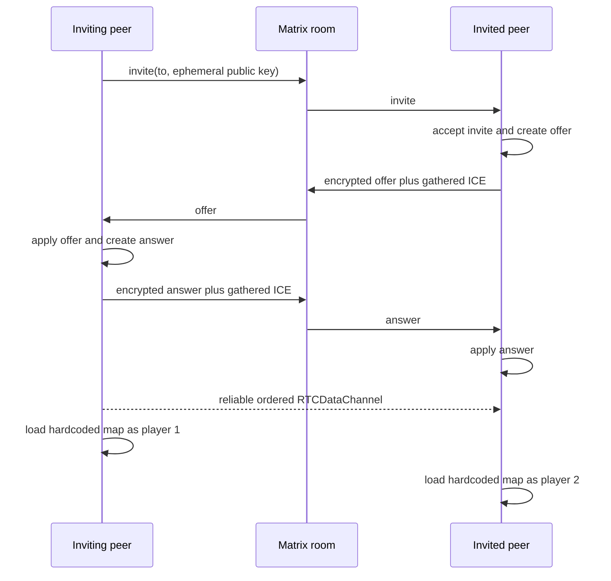

# MB2 WebRTC and lobby port analysis

This document analyzes the current two-player path in Moving Boxes 2 (MB2) and defines the boundary for a Phonics port. The Subspace/WebSocket experiment is deliberately excluded. The target is an HTML lobby followed by a direct launch into the world's declared starting level when two players have connected.

## Recommendation

Keep MB2's direct peer connection and invite flow as product behavior, but do not copy its networking classes or frame synchronization algorithm. The port should have four independent layers:

1. Phonics browser primitives own lobby lifecycle, signaling contracts, WebRTC channels, compatibility negotiation, bounded queues, cancellation, and cleanup.
2. A separately packaged lobby adapter owns Matrix authentication, presence, invitations, signaling delivery, and optional lobby chat.
3. Phonics PHP primitives own session ticks, peer and network-entity identities, authority, replication registration, snapshot history, interpolation, and reconciliation support.
4. Each game package owns its player factories, input and component codecs, replicated archetypes, shared-world rules, respawn behavior, HUD, and multiplayer system sets.

The first implementation should support two players with one host authoritative over gameplay. A client predicts its own player from local input, the host validates and simulates both players and shared entities, and authoritative snapshots reconcile the client. Remote actors and shared entities render from a short interpolation buffer.

This preserves responsive local controls without relying on deterministic simulation. It also gives rings, enemies, vehicles, breakables, bosses, and level events one authority instead of allowing both peers to diverge.

## What MB2 does today

The relevant implementation is spread across these MB2 files:

| Concern | Source |
| --- | --- |
| Offerer-side WebRTC wrapper | `app/network/RtcClient.js` |
| Answerer-side WebRTC wrapper | `app/network/RtcServer.js` |
| Matrix presence, chat, invites, and signaling | `app/network/Lobby.js` |
| Signaling-payload encryption | `app/network/CryptoMessageService.js`, `CryptoMessage.js`, and `CryptoReply.js` |
| Manual token exchange | `app/Menu/MainMenu.js` |
| Player creation, packet send/receive, and serialization | `app/viewport/Viewport.js` |
| Network-specific respawn behavior | `app/behavior/Platformer.js` |

No automated networking tests were found in MB2. The port therefore needs behavioral fixtures around the useful flows rather than treating the current implementation as an executable specification.

### Connection topology

`RtcClient` creates one data channel named `chat` and an SDP offer. `RtcServer` accepts the channel and creates the answer. No channel options are supplied, so gameplay and peer chat share one reliable, ordered channel.

The wrappers collect ICE candidates into the offer and answer instead of sending trickle ICE updates. The default settings supply public STUN servers and no TURN relay. `send()` silently discards a message unless the channel is open, and `close()` closes only the peer connection. There is no backpressure, timeout, reconnect, cancellation, connection-state model, packet limit, or protocol version.

The two wrappers duplicate almost all behavior. They also install some listeners at unsafe times: the manual `fullOffer()` and `fullAnswer()` paths begin local-description work before installing the completion listener, so an early ICE completion event can be missed. `RtcServer` additionally attaches an `icecandidate` listener to the data channel even though ICE events belong to the peer connection.

### Lobby handshake

The current Matrix path uses a public room for presence, public chat, invitations, and targeted signaling events. Its successful flow is:



The invited peer becomes the WebRTC offerer and player 2. The inviting peer becomes the answerer and player 1. When either wrapper reports an open channel, `Lobby.refreshRtc()` loads `/map/emerald-isle.json` directly. The manual flow performs the same SDP exchange using `s3ktp://request/...` and `s3ktp://accept/...` strings copied between players.

The lobby derives its user list from any room event in up to seven days of history. A step-out event adds a status message but does not remove the user. There is no presence expiry, invitation expiry, join state machine, recovery, or timeout. Invite rate limiting is local and covers only one invite per sender every 15 seconds.

### Signaling security

MB2 encrypts each signaling reply with a new AES-GCM key and encrypts that key, together with its IV, using an ephemeral RSA-OAEP public key from the preceding message. This keeps SDP and ICE details out of plain room-event content under normal operation, and AES-GCM authenticates the encrypted payload.

The exchange does not authenticate the ephemeral key to the Matrix identity. A pending request stores only a UUID and private key; it does not bind the expected sender, room, message type, expiry, or state transition. Any room participant that observes an invitation can encrypt a reply to its public key, and the first reply using the UUID consumes the pending key. Rejected and abandoned chains also leave pending keys behind. The implementation has no replay window, schema validation, payload-size limit, or cryptographic transcript tying the Matrix sender to the WebRTC DTLS fingerprint.

The custom crypto chain should not be ported. The Matrix adapter should use an authenticated, maintained Matrix encrypted-message path where available. A provider without authenticated signaling must require a human-verifiable authentication code derived from the offer/answer transcript and DTLS fingerprints. WebRTC still provides encrypted media/data transport after authentication; signaling encryption by itself does not establish peer identity.

### Gameplay synchronization

Every game update, each peer serializes its local controller plus selected mutable player fields and sends JSON over the same reliable channel used by chat. The fields include position, ground and axis speed, facing, movement flags, angle and mode, rings, ground angle, death, and respawn state.

On receipt, MB2:

1. moves its global frame ID forward when the remote frame is newer;
2. replays the remote input and calls the actor's input method;
3. assigns the received fields directly onto the remote actor; and
4. toggles collision bypass from the received death state.

Frame-based timeouts and intervals are invoked for every skipped frame ID, while ordinary physics updates are not replayed for those frames. Periodic platforms derive their phase from the shared frame number. This aligns a subset of timed objects but can skip transitions and produces asymmetric simulation when one peer advances the other.

The model is local authority over each player, rather than rollback, delayed-input lockstep, or server authority. Shared actors and world mutations are not replicated. Collection, destruction, enemy decisions, random outcomes, boss state, and level events can therefore disagree even when player coordinates appear synchronized.

Full JSON snapshots on every update also create avoidable bandwidth and garbage. Reliable ordering causes head-of-line blocking when an obsolete state packet is delayed, and `send()` does not inspect `bufferedAmount`. The receiver has no stale-sequence rejection, interpolation buffer, schema validation, or numeric bounds checks before mutating actor state.

### Direct peer timing regression

`tests/network-timing.php` models the part of MB2's flow that remains after signaling: two directly paired peers exchanging data-channel packets, with no Matrix provider or lobby state involved. The fixture uses Phonics' real binary packet codec and `BrowserBridge` on both ends, while a deterministic queue supplies one tick of link latency.

The regression starts the guest at tick 1,482 and the host at tick zero. It verifies that an obsolete input is discarded without terminating the host, the next host snapshot rebases the guest's match clock, the rebased input is accepted, locally owned predicted motion is not overwritten by a host snapshot, recreating a map replication system does not reset the match clock, and delayed traffic from the previous map scope is ignored. A second trace keeps the guest six ticks ahead, inside the clock's transit tolerance, and proves that the host queues those commands until they become due while the guest advances monotonically instead of returning to spawn. Snapshot acknowledgements only retire command history; they do not write old actions over input sampled during the current frame. This isolates simulation timing from signaling and reproduces the failure boundary without depending on a public Matrix room, ICE, or browser scheduling.

The movement trace exposed several separate discontinuities. Applying host snapshots to the guest-owned `Transform` and `Velocity` discarded local prediction every other tic, while rebuilding a remote `Transform` detached the renderer's cached pose and reset its fixed-step history. Replaying unacknowledged command objects only changed the mutable input component and did not replay physics, so an acknowledgement could replace newly sampled input with older actions. The guest also simulated the remote player between host snapshots and repeatedly corrected that speculative pose. Owner-authoritative filtering now keeps the local pose, acknowledgements leave current input alone, guests reserve remote-player movement for host snapshots, and the Doom transform codec reconciles those snapshots into the existing object while retaining the old pose as the next render endpoint. The package regression checks local/remote simulation ownership, object identity, and the midpoint rendered across a correction.

## What to preserve and what to replace

| MB2 behavior | Port decision |
| --- | --- |
| Browser-to-browser WebRTC gameplay | Preserve as the first transport. |
| HTML user list, invitations, accept/reject, and lobby chat | Preserve as browser UI backed by a lobby adapter. |
| Manual offer/answer exchange | Retain later as a provider-independent fallback, with a versioned token and verification code. |
| Two-player host/join roles | Preserve for the first slice, expressed as `PeerRole` values rather than client/server wrapper classes. |
| A simulation tick on each gameplay packet | Preserve, without assigning a remote value to the local engine clock. |
| Hardcoded level and concrete player classes in the lobby | Replace with the world's `start` scope and game-owned factories. |
| One reliable channel for state, control, and chat | Replace with reliable control and disposable realtime channels. |
| Full actor-field JSON every update | Replace with registered, versioned binary codecs and rate-limited snapshots. |
| Direct `Object.assign` into actor state | Replace with validated component codecs and reconciliation policies. |
| Global frame jumps | Replace with clock-offset estimation, authoritative snapshot ticks, and a start barrier. |
| Peer authority over separate player objects | Replace with a host-authoritative shared simulation and local prediction. |
| Custom RSA/AES Matrix messages | Replace with authenticated provider signaling or explicit fingerprint verification. |
| Seven-day event history as presence | Replace with provider presence plus heartbeat/expiry semantics. |
| STUN-only connectivity | Add host-approved TURN configuration and actionable connection diagnostics. |

## Phonics ownership boundaries

### Browser framework primitives

Phonics should provide these game-neutral services:

- `LobbyController`: a finite state machine for authentication, presence, invitation, signaling, connection, compatibility, loading, readiness, and closure.
- `LobbyProvider`: an adapter contract for identity, presence, invitations, opaque signaling messages, and optional chat.
- `PeerTransport`: a transport contract exposing typed channels, state changes, backpressure, diagnostics, cancellation, and idempotent cleanup.
- `WebRtcTransport`: the browser implementation using one `RTCPeerConnection` and explicit control and realtime data channels.
- `MatchDescriptor`: an immutable description of protocol version, world digest, package-graph digest, game export, start scope, player count, negotiated content manifest, and feature set.
- `MatchHandle`: a session-owned handle for one connected, compatibility-checked match.
- `NetworkBridge`: bounded browser-to-PHP queues and send functions exposed through the WASM bridge.

These are browser services because authentication, WebRTC, asynchronous signaling, DOM lifecycle, and network policy are browser concerns. They must be session-scoped and register cleanup with the same reverse-order lifecycle used by `Phonics.loadWorld()`.

The core HTML lobby can render neutral status, player rows, invitations, chat, errors, and progress. A game package may supply title, artwork, copy, and CSS metadata, but cannot replace connection-state semantics. All remote strings must enter the DOM as text.

### Lobby adapter package

Matrix-specific behavior belongs in an independently published adapter, not in Phonics core or Sane-Phonics. It owns:

- OAuth 2.0 authorization-code login with PKCE, dynamic registration, refresh, and session restoration;
- homeserver and room configuration;
- current presence with expiry;
- invite, accept, reject, cancel, and signaling delivery;
- authenticated encrypted signaling where supported;
- Matrix-specific rate limits and error translation; and
- optional persistent lobby chat.

The adapter must not instantiate game entities, select a world scope, assign player numbers, or start the PHP runtime. It reports provider identities and messages to `LobbyController`.

The Matrix homeserver and lobby channel can be changed on the game's Networking settings page before connecting and persist as user defaults. The chat lobby only presents sign-in and room activity. An explicit session/host provider setting takes precedence over `network.lobby.options.homeserver` in the world; when both are absent, the provider uses `https://matrix.org`. The chosen URL must still pass the host's `signalingOrigins` policy, and every client endpoint and restored OAuth session is derived from or keyed by that normalized homeserver. Login opens the homeserver's authorization page in a centered popup, as MB2 does, while the loaded world remains active. The callback sends its same-origin authorization response to the opener, closes, and lets the original provider exchange the code. Access tokens do not cross the popup channel, and Phonics never collects a Matrix password.

### PHP framework primitives

Phonics should provide value objects and systems around network identity and time, instead of passing primitive arrays through the registry:

- `PeerId`, `SessionId`, `NetworkEntityId`, and `SimulationTick` immutable values;
- `PeerRole` and `Authority` enums;
- `NetworkIdentity` and `NetworkOwnership` ECS components;
- a `ReplicationRegistry` for explicitly registered component, input, event, spawn, and despawn codecs;
- a `NetworkClock` that estimates host tick offset without changing `Engine::$time` or the fixed-step accumulator;
- snapshot history, stale-packet rejection, interpolation, and reconciliation helpers;
- packet budgets, sequence and acknowledgment tracking, and replication diagnostics; and
- receive and publish systems with explicit scheduler dependencies.

Local registry IDs remain process-local. `NetworkEntityId` is the stable identity carried over the wire and mapped to the local entity created by a game-owned factory.

The live peer connection lasts for the game session and can cross source-scope transitions. Replication systems and replicated entities may be owned by a `ScopeContext`, so leaving a map removes its game objects without closing the connection. A scope-specific `SystemSet` registers codecs and systems for the active content format.

### Game-package responsibilities

Sane-Phonics or another game package owns:

- multiplayer player and spawn factories;
- mapping local `Controls` into game input commands;
- schemas for movement, rings, shields, vehicles, animation, and other game components;
- which actions are predictable, authoritative, reliable, or cosmetic;
- host simulation rules for enemies, pickups, breakables, bosses, and level progression;
- respawn, checkpoint, score, camera, split-screen, and disconnect policy;
- multiplayer HUD and game-specific lobby presentation; and
- the scope-bound system set that composes those rules with Phonics replication primitives.

Core never names Sonic, rings, shields, a campaign map, or a concrete player component. Doom-Phonics, PHP/Noid, or a future game can use the same transport and lobby contracts with different codecs and authority rules.

## HTML lobby and direct level boot

The generic host should continue to call `Phonics.loadWorld(worldUrl, options)`. Multiplayer is declared by the world, so the host does not gain a game-selection table or game-specific scene option.

The normal flow should invoke the lobby as an HTML overlay from the game-owned menu:

1. `loadWorld()` reads the world, verifies the package graph, and activates the PHP game and its declared browser networking modules.
2. The title screen runs without opening a content source that still has unresolved resource slots.
3. The game menu's **Online Play** item invokes the session's neutral `LobbyService`.
4. The service acquires modal input, renders the HTML overlay above the canvas, and leaves game-specific menu placement and labeling to the game.
5. The players resolve required content, establish WebRTC, and exchange a compatibility hello.
6. The resulting `MatchHandle` remains owned by the existing Phonics session and becomes available to its PHP `NetworkSession` bridge.
7. The game activates the world's existing `start` source and scope directly, with no second game or level menu.
8. The HTML loading layer remains visible while both peers load. Each peer sends `game-ready`; the host chooses a future start tick and sends `start`.
9. Fixed-step simulation begins together and the overlay transitions away.

Cancellation releases modal input and restores the previous menu focus. A load failure or compatibility rejection closes the connection and returns to the lobby. `session.dispose()` closes all channels, peer-connection listeners, provider subscriptions, queues, and DOM ownership.

The same `LobbyService` may auto-open after the title scene becomes ready for invitation links or worlds whose network declaration requires multiplayer. Both activation policies use the same overlay and session lifecycle; auto-open does not introduce a separate networking implementation.

The public host API remains one-step and game-neutral:

```js
// Public host code remains game-neutral.
const session = await Phonics.loadWorld(worldUrl, {
  canvas,
  runtime: {url: '/runtime/php8.4-sdl.mjs'},
  signal,
  policy: {
    codeOrigins: [location.origin],
    signalingOrigins: ['https://matrix.example'],
    iceServers
  }
});
```

`signalingOrigins` and `iceServers` are host security/connectivity policy. The world may request a provider, room, player count, and game mode, but it cannot silently add an ICE server or relax an origin policy.

An illustrative neutral-world declaration is:

```json
{
  "type": "phonics-world",
  "schemaVersion": 1,
  "imports": {
    "sane": "../sane-phonics/phonics.json",
    "matrix": "../phonics-matrix/phonics.json"
  },
  "game": "@sane/game",
  "network": {
    "activation": "menu",
    "players": {"min": 2, "max": 2},
    "lobby": {
      "provider": "@matrix/lobby",
      "options": {"room": "#sane-phonics:example.org"}
    },
    "transport": "@phonics/webrtc"
  },
  "sources": {
    "campaign": {
      "adapter": "@phonics/tiled",
      "resources": [{"url": "./campaign.world"}]
    }
  },
  "bindings": [
    {
      "id": "networked-platformer",
      "use": "@sane/co-op",
      "on": {"source": "campaign", "kind": "map"},
      "options": {"authority": "host"}
    }
  ],
  "start": {"source": "campaign", "scope": "emerald-isle"}
}
```

The exact export names are prospective. The important split is that `network` chooses neutral browser services, the binding chooses game behavior, and `start` chooses the level. The lobby never contains `emerald-isle`, a player class, or a package-specific mode switch.

## Peer-supplied and locally required content

The player creating a match must be able to assemble an ordered WAD stack while keeping locally owned files and acquisition URLs private. This is a game-neutral resource negotiation feature: the world declares one or more resource slots, the host fills them with files or URLs, and the lobby carries safe requirements and verified content identities to the peer.

The remote player cannot add an arbitrary resource or change how bytes are interpreted. A local world definition fixes all of these values:

- the source and resource-slot identity;
- the content adapter;
- the resource role, such as `iwad` or `pwad`;
- whether the slot is required and whether it accepts one or several ordered resources;
- URL scheme, byte-size, and data-origin policy;
- format-specific validation supplied by the adapter; and
- which player has authority to propose the value.

An illustrative Doom world can declare a host-filled base archive while retaining fixed package resources:

```json
{
  "type": "phonics-world",
  "schemaVersion": 1,
  "imports": {
    "doom": "../doom-phonics/phonics.json"
  },
  "game": "@doom/game",
  "resourceSlots": {
    "wad-stack": {
      "type": "url",
      "distribution": "local",
      "label": "WAD load order",
      "required": true,
      "multiple": true,
      "authority": "host",
      "accept": [".wad", "application/x-doom-wad"],
      "stack": {
        "first": {
          "id": "doom-base",
          "names": ["DOOM1.WAD", "DOOM.WAD", "freedoom1.wad"],
          "inspector": "@doom/wad-inspector",
          "equivalence": "profile",
          "criteria": {"archiveType": "IWAD"}
        },
        "following": {
          "id": "doom-overrides",
          "names": ["*.wad"],
          "inspector": "@doom/wad-inspector",
          "equivalence": "integrity",
          "criteria": {"archiveTypes": ["IWAD", "PWAD"]}
        }
      }
    }
  },
  "sources": {
    "episode": {
      "adapter": "@doom/wad",
      "resources": [
        {"slot": "wad-stack", "role": "wad"},
        {"url": "./DBIGFONT.WAD", "role": "pwad"}
      ]
    }
  },
  "bindings": [
    {
      "id": "episode-gameplay",
      "use": "@doom/episode",
      "on": {"source": "episode", "kind": "map"}
    }
  ],
  "start": {"source": "episode", "scope": "E1M1"}
}
```

The reusable launcher renders one ordered drop zone from this declaration. It does not contain Doom-specific field code. Doom-Phonics validates each WAD header, lump directory, content profile, and available map catalog after the neutral loader has obtained the bytes. Its single-player action uses the same declarations and binding path without entering a network match, while the lobby opens the launcher as an overlay for match setup.

Declared session fields may set `local: false` to omit multiplayer-only settings from local launches, or supply a `local` object overriding their `default` and `options`. The launcher retains separate local and online values. Local selections carry `settings` on the bound world returned by `phonicsContentWorld()`. After `resourcesmounted`, the game activates that world and calls `phonicsContentReady(null)` on success or `phonicsContentReady(message)` on failure. The launcher remains open until that acknowledgment and displays failures for retry.

The host-to-peer flow is:

1. The host drops files or selects allowed URLs, then sorts each multiple-resource slot.
2. `ResourceStore` reads each selection under the host's data-origin and size policy and computes SHA-256 over the received bytes.
3. Doom-Phonics performs a bounded format probe and reports the archive type, profile, and map catalog for the lobby summary.
4. The lobby forms ordered `ResourceOffer` records containing the slot ID, SHA-256 digest, byte length, declared role, safe filename, and inspector profile. A retrievable public resource may also carry its URL; a local resource never does.
5. The invitation carries safe filenames, profiles, ordering, the selected map, and the match descriptor digest. Local paths, blob URLs, credential-bearing URLs, and bytes never enter Matrix or WebRTC messages.
6. The joining peer selects local files that satisfy the same declared slots and ordering. Exact resources must match by digest. A stack may allow a declared compatible profile for its first entry while requiring every following override to match exactly.
7. Both sides independently mount their verified resources and bind the same selected `start.scope`.
8. The ordered resource descriptors become part of the `MatchDescriptor`. Both peers must report content-ready before source activation and the gameplay start barrier.

The WAD bytes themselves are not sent through the realtime gameplay channel. A later file-transfer provider could implement the same resource-slot contract, but it would remain separate from WebRTC state replication.

Source resources remain bindable until their source is first opened. `SourceDefinition` accepts unresolved slot placements, and `WorldRuntime::bindWorld()` replaces them with a verified immutable resource list before activation. Binding a missing slot, rebinding an active source, or changing its declared adapter fails explicitly. Fixed-resource worlds still follow the immediate preload path.

The Doom-Phonics repository world declares one user-controlled WAD stack followed by immutable support resources. The first entry must be an IWAD; later IWADs and PWADs participate in the same last-archive-wins lookup. This lets an earlier complete archive supply an Episode map while a later complete archive contributes weapons, sprites, sounds, and commercial-map scopes. The stack's first requirement uses profile equivalence; its following requirement uses exact integrity. Opening WAD Stack or Game settings resolves the chosen order, closes the current scope, transactionally rebinds the source, and stages the selected map for either immediate local play or the network readiness barrier.

Acquisition sources are session-private data. Phonics does not place credential-bearing queries, local paths, or object URLs in chat history, invitations, match messages, analytics, or ordinary diagnostics. Errors can identify the origin and slot while redacting URL user information and query values.

Some required archives cannot be redistributed. Those slots use `distribution: "local"` instead of carrying an acquisition URL. The invitation and WebRTC handshake carry a `ResourceRequirement`: safe display names, discovery filenames, an inspector export, common compatibility criteria, accepted content profiles, and whether peers need equal bytes or compatible profiles. Each peer resolves the slot from a file picker, an approved local URL, or a declared freely distributable replacement. Local paths, blob URLs, credential-bearing URLs, and file bytes never enter Matrix or WebRTC messages.

This follows GZDoom's separation between discovery and identity. Its
[`ScanIWAD`](https://github.com/ZDoom/gzdoom/blob/master/src/d_iwad.cpp#L344-L394) implementation uses candidate names to find archives, then identifies them from the lump signatures in ordered
[`IWADINFO`](https://github.com/ZDoom/gzdoom/blob/master/wadsrc_extra/static/iwadinfo.txt) records. The records run from the most specific signature to a broad fallback: for example, Freedoom Phase 1 requires `E1M1`, `E2M1`, `E3M1`, and `FREEDOOM`, while the distinct Freedoom demo record requires only `E1M1` and `FREEDOOM`. `Required` names another identified IWAD dependency, and a PWAD's `GAMEINFO` can request an `IWAD` filename that is matched against an `IWADName`. Doom-Phonics uses the same shape through its adapter inspector: a filename is a UI hint, then the WAD header, directory bounds, archive role, marker lumps, map namespace, and selected maps establish compatibility.

GZDoom also deliberately [avoids silently adding optional support archives in a network game](https://github.com/ZDoom/gzdoom/blob/master/src/d_iwad.cpp#L860-L875): every loaded WAD must be named explicitly so the host knows the exact stack. Phonics applies that rule to every override, support, font, definition, and map WAD. Each is a declared stack entry or world-owned resource and contributes its digest to the match descriptor. A candidate replacement applies only where the local requirement declares it; it never substitutes for a later override or silently changes stack order.

Fixed support resources use `authority: "world"`. Such a slot requires a canonical `defaultUrl` and pinned integrity, cannot be changed through the lobby, and is still offered in source-stack order so it contributes to the match content identity. User-selectable URLs remain `host`, `guest`, or `either` authority. A public host may explicitly allow `dataOrigins: "*"` for CORS-readable game data such as WADs; this does not relax `codeOrigins`, and every retrieved resource still passes the slot's size, type, format, and integrity checks.

For example, a map pack which supplies its own `MAP01` can accept either owned base data or Freedoom Phase 2:

```json
{
  "resourceSlots": {
    "base-wad": {
      "type": "url",
      "distribution": "local",
      "label": "Doom-compatible base data",
      "required": true,
      "authority": "host",
      "accept": [".wad", "application/x-doom-wad"],
      "requirement": {
        "id": "doom2-base",
        "inspector": "@doom/wad-inspector",
        "equivalence": "profile",
        "profileRequires": ["match-wad"],
        "names": ["DOOM2.WAD"],
        "criteria": {
          "archiveType": "IWAD",
          "mapNamespace": "commercial"
        },
        "candidates": [
          {
            "id": "doom2",
            "label": "Doom II",
            "names": ["DOOM2.WAD"],
            "criteria": {"mustNotContain": ["FREEDOOM", "FREEDM"]}
          },
          {
            "id": "freedoom.phase2",
            "label": "Freedoom: Phase 2",
            "names": ["freedoom2.wad"],
            "criteria": {"mustContain": ["MAP01", "FREEDOOM"]},
            "url": "https://static.example/freedoom2.wad",
            "integrity": "sha256-..."
          }
        ]
      }
    },
    "match-wad": {
      "type": "url",
      "distribution": "retrievable",
      "label": "Match map WAD",
      "required": true,
      "authority": "host",
      "accept": [".wad", "application/x-doom-wad"],
      "requirement": {
        "id": "match-map",
        "inspector": "@doom/wad-inspector",
        "equivalence": "integrity",
        "names": ["match.wad"],
        "criteria": {"archiveType": "PWAD", "requiredMaps": ["MAP01"]}
      }
    }
  }
}
```

The replacement URL above is illustrative; a published world must pin a real version and integrity digest. Candidate order is significant, as it is in GZDoom's easiest-to-recognize-first IWAD table. An inspector tests common criteria and then candidates in order. An archive named `DOOM2.WAD` which lacks the required contents fails.

`equivalence: "profile"` is an explicit game-author decision. It is suitable when the transferable PWAD supplies the gameplay-defining map and the IWAD supplies compatible base assets and definitions. `profileRequires` names the exact resource slots which must be present and byte-identical before two peers may resolve the profiled slot to different bytes. If the selected map comes from the IWAD itself, use `equivalence: "integrity"`, or leave the profile guard unresolved so a differing IWAD fails; substituting Freedoom's different map would otherwise make the peers simulate different worlds. Add-on PWADs, DECORATE, SNDINFO, and other gameplay definitions remain ordered, digest-identified resources unless their adapter defines a narrower safe equivalence.

## Transport and protocol shape

Use two channels from the outset:

| Channel | WebRTC delivery | Contents |
| --- | --- | --- |
| `control` | Reliable and ordered | hello, compatibility result, ready/start, spawn/despawn, critical events, chat, transition, and disconnect reason |
| `realtime` | Unordered with zero or a small retransmit limit | input windows, snapshots, transforms, acknowledgments, clock samples, and transient effects |

Input packets repeat a short window of recent commands, so losing one realtime packet does not lose a button edge. Obsolete snapshots are discarded by sequence and tick. The sender drops disposable realtime data above a `bufferedAmount` threshold; it never silently drops reliable control messages. Packet-size and queue limits are enforced before decoding.

Every packet needs a compact framework header with protocol version, message kind, session identity, sender identity, sequence, simulation tick, acknowledgment data, schema/version identity, and payload length. Game payloads are produced only by registered codecs. There is no reflection-based dump of arbitrary component fields.

Before gameplay loads, both peers compare:

- Phonics network protocol version;
- canonical game export and package versions;
- integrity-derived package graph digest;
- normalized world-content digest and selected start scope;
- ordered resolved-resource slots with their roles, byte lengths, and content digests;
- replication schema IDs and versions;
- fixed-step frequency and required features; and
- host/client role and player-slot assignment.

Canonical URLs are useful diagnostics but cannot be the only equality key because a valid world can be relocated. A content digest establishes equality. A peer-supplied URL must never cause Phonics to load executable code or weaken the host's origin policy.

## Simulation model

The host advances the authoritative fixed-step simulation. Clients send numbered input commands tagged with the tick for which they were sampled. The host applies accepted commands, simulates shared state, and publishes snapshots at a lower configured rate than input sampling.

The client keeps its unacknowledged inputs. When an authoritative snapshot arrives, it restores the confirmed local-player state and replays later inputs. It interpolates remote and non-predicted entities between buffered host snapshots. Each game codec defines the fields needed to restore and interpolate its component; core supplies the history and scheduling mechanism.

The first port does not need rollback for the entire world or host migration. It does need:

- a bounded input history;
- a bounded snapshot history;
- one stable host tick;
- input validation and rate limits;
- authoritative spawn/despawn and world events;
- explicit handling for scope transitions and respawn; and
- a clear disconnect result when the host leaves.

This model is more work than MB2's actor-field copy, but it solves the shared-world disagreement that otherwise appears as soon as two players touch the same pickup, enemy, breakable object, or checkpoint.

## Port sequence

### 1. Characterize the retained flows

- Build fixtures for invite, accept, reject, cancel, offer, answer, connection, and disconnect.
- Record the MB2 player-field list only as migration input for Sane-Phonics codecs.
- Add an in-memory lobby provider and fake peer transport so tests do not depend on a public Matrix room or NAT behavior.

### 2. Add browser session primitives

- Implement `LobbyController`, provider and transport contracts, immutable match values, and explicit state transitions.
- Implement WebRTC with trickle ICE, control/realtime channels, backpressure, abort support, TURN-aware diagnostics, and idempotent cleanup.
- Activate a session-owned HTML lobby service that a game menu can invoke or a world can auto-open.
- Add modal focus/input ownership, an accessible lobby, and a loading/readiness overlay.
- Add declarative resource slots and ordered local/retrievable content resolution before a lazy content source opens.

### 3. Add protocol and PHP bridge primitives

- Implement the compatibility hello and a versioned binary envelope.
- Add bounded bridge queues and expose them to PHP through a core-owned service rather than game-named `vrzno_env` globals.
- Add peer, tick, network-entity, ownership, codec registry, history, and diagnostics types.
- Register receive and publish systems with explicit ordering around game systems.

### 4. Port game-owned multiplayer behavior

- Create game-owned multiplayer `SystemSet` implementations, player factories, input codecs, and replicated component codecs.
- Make the host authoritative over both players and all shared entities.
- Add local prediction/reconciliation, remote interpolation, respawn, scope transition, and disconnect behavior.
- In Doom-Phonics, negotiate the ordered WAD stack and selected map before opening the WAD source.
- Enter the world's start scope directly for a matched session and keep ordinary single-player startup unchanged.

### 5. Add the Matrix adapter

- Implement authenticated identity, expiring presence, invite state, encrypted signaling, cancellation, and optional chat behind `LobbyProvider`.
- Keep provider events independent of WebRTC roles and game player slots.
- Use homeserver OAuth metadata, dynamic registration, PKCE, and renewable sessions without accepting passwords in the game UI.

## Acceptance checks

The port is ready for a first playable slice when all of these hold:

- Two isolated browser contexts can meet in the HTML lobby and boot the same declared start level without a game-specific host script.
- One player can offer an ordered WAD stack by safe filenames and identities, the other can satisfy it from local or declared retrievable bytes, and both activate only after compatible profiles and exact guard digests match.
- Core and the lobby adapter contain no Sane-Phonics class names, map URLs, component fields, or gameplay rules.
- Sane-Phonics contains no Matrix, SDP, ICE, or DOM-lobby implementation details.
- The connection survives content and level loading and is closed exactly once on cancellation, load failure, disconnect, or session disposal.
- Compatibility failures identify the differing world, package, protocol, or schema before simulation starts.
- Packet decoding rejects malformed, oversized, stale, wrong-session, and unsupported-schema data without mutating ECS state.
- A deterministic transport simulator exercises latency, jitter, loss, duplication, and reordering; reliable control completes while obsolete realtime state is dropped.
- A two-browser test covers input, collection of the same pickup, an enemy interaction, respawn, a scope transition, chat, and cleanup.
- One client cannot assign arbitrary component fields, spawn unregistered archetypes, select a different level, or cause executable packages to load.
- Core-only and a non-Sane fixture game can use the same lobby, transport, and replication primitives.

## Immediate implementation slice

The smallest reviewable slice is a session-owned HTML lobby and transport contract with in-memory adapters. A real game-menu item should open and close the overlay while preserving focus. The slice should stop at a connected, compatibility-checked `MatchHandle` and prove that both sessions can resolve independently owned copies of the same declared WAD stack, hold their engines at tick zero until ready, and boot the declared start scope. Gameplay replication should follow separately so transport lifecycle, resource negotiation, and game authority can be reviewed independently.
